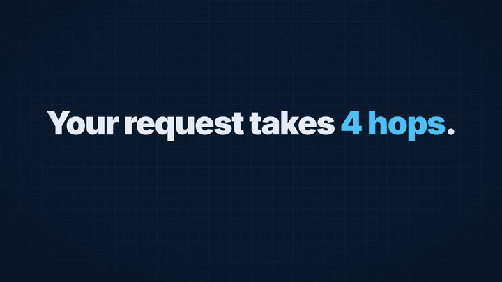

<h1 align="center">tech-to-motion</h1>

<p align="center"><strong>Turn your real tech into a motion-design explainer video.<br>
Animated architecture diagrams, flowing requests, terminals that type, failures that glitch, synced sound.<br>
From your docker-compose, Terraform, Kubernetes, CI pipeline, postmortem or changelog.</strong></p>

<p align="center">
  
  
  
  <a href="./LICENSE"></a>
</p>

<p align="center">
  <a href="assets/demo-k8s-oomkilled.mp4"></a><br>
  <sub>▶ <a href="assets/demo-k8s-oomkilled.mp4">Watch the full 27 s video with sound</a> · made from a
  <a href="examples/k8s-oomkilled/source/deployment.yaml">deployment.yaml</a> and
  <a href="examples/k8s-oomkilled/source/incident.md">incident notes</a> with one prompt</sub>
</p>

Most AI motion-graphics skills make generic promo videos. This one is built for engineers:
it **reads your actual source**, picks the one idea worth explaining, and animates it in the
ByteByteGo / Fireship style, with nothing invented. You get an MP4 with sound, ready for
LinkedIn, YouTube Shorts, a README or a talk.

## Your stack in, a video out

```text
You:    Make a 30-second explainer of this docker-compose for LinkedIn.

Agent:  🔎 docker-compose.yml: 5 services (vote, result, worker, redis, db)
        🔗 vote → redis, worker → redis + db, result → db
        💥 Angle: your vote never touches the database. The worker does.

        🎬 "Your vote never touches the database" · 30 s · 1:1 · blueprint
        | s1 | 0–3   | Hook, on screen at frame 0                 | settle + impact   |
        | s2 | 3–12  | vote → Redis → worker → Postgres → result  | build, packet run |
        | s3 | 12–20 | dive into the worker: queue → INSERT        | zoom, typing      |
        | ...
        Go, or change something?

You:    go

Agent:  ✅ s1 … ✅ s5 · check: 0 errors · 7 stills reviewed
        ✅ renders/voting-app.mp4 · 30.0 s · 1080x1080 · sound · 9.6 MB
```

## How it works

| Step | What happens |
|---|---|
| **1. Brief** | One message at most. Duration, ratio and look have defaults; LinkedIn implies 1:1, Shorts implies 9:16. |
| **2. Read** | The agent reads your files and shows each finding live. Every name, port and number it will show goes in a **facts ledger** with its source line. |
| **3. Storyboard** | Scene-by-scene plan with exact on-screen text and timing. You say "go" or change it. |
| **4. Build** | Scenes are written with the **TTM motion kit**: diagrams with real tech logos, packets, typing, swaps, failures, camera dives. |
| **5. Quality loop** | Automatic checks (overlaps, text size, contrast, reading time, dead frames), then the agent **opens still frames** and fixes what looks wrong. Up to 3 rounds. |
| **6. Render** | MP4 with synthesised sound effects synced to the motion, loudness-normalised, verified (duration, streams, black frames, silence). |

## The motion kit

A small library the agent uses instead of improvising animation code, so every video gets
studio timing by default:

- **`TTM.diagram`**: nodes with Simple Icons logos, auto-sized boxes, routed edges and
  arrowheads, built in data-flow order.
- **`d.flow`**: request and response packets travelling the edges with a short tail; the
  target node pulses and ticks on arrival.
- **`TTM.type` / `TTM.stream`**: a terminal that types like a human (seeded rhythm, real
  caret) and streams output line by line.
- **`TTM.fail` / `TTM.ok`**: failure in two frames (colour, shake, RGB glitch, error sound),
  success with a pulse and a ding.
- **`TTM.dive`**: the zoom-through from the map into one component.
- **`TTM.swap`, `TTM.count`, `TTM.highlight`, `TTM.focus`**: value changes, counters, code-line
  highlights, dimming everything but the focus.

Every helper also logs the sound its motion implies. At render time the sounds are
**synthesised** (whoosh, pop, tick, typing, riser, impact, glitch, ding): no audio files, no
licences, same result every time.

## Formats and looks

| Format | From |
|---|---|
| Architecture explainer | docker-compose, Kubernetes manifests, Terraform, a diagram, a repo |
| CI/CD pipeline | GitHub Actions, GitLab CI, Jenkinsfile |
| Incident story | a postmortem, alert, logs |
| Release video | CHANGELOG, release notes |
| "X in 60 seconds" | any concept |
| Terminal demo | a CLI and its README |
| Repo trailer | your README |

Looks: **blueprint** (the signature: navy grid, cyan accents), **terminal**, **neon**,
**paper**. Ratios: 16:9, 9:16, 1:1, 4:5, with a type scale that adapts to each.

## Install

**Any agent** (Claude Code, Codex, Cursor, Gemini CLI, GitHub Copilot, OpenCode and more),
with the [skills CLI](https://github.com/vercel-labs/skills):

```bash
npx skills add georgesmomo/tech-to-motion
```

**Claude Code plugin:**

```text
/plugin marketplace add georgesmomo/tech-to-motion
/plugin install tech-to-motion@tech-to-motion
```

**Manual:** copy `skills/tech-to-motion/` into your agent's skills folder.

**Requirements:** Node.js 22+. On first use the skill installs a pinned toolchain in
`~/.cache/tech-to-motion` (HyperFrames, a static ffmpeg, GSAP, Simple Icons; about a minute),
and the first render downloads a headless Chrome (~260 MB). Network is needed for those two
steps and to fetch fonts once. No API key. Telemetry is turned off.

## Use

| Say | What happens |
|---|---|
| `Make an explainer video of this repo's architecture` | reads the repo, 30 s, 16:9 |
| `30-second LinkedIn video of our docker-compose` | 1:1, muted-first (all ideas on screen) |
| `Vertical Short explaining our CI pipeline, terminal look` | 9:16, terminal look, pipeline format |
| `Turn this postmortem into a 45 s incident video` | incident format: alert, investigation, root cause, fix |
| `Release video for v2.0 from the CHANGELOG` | version slam, feature cards, upgrade command |
| `Kafka consumer groups in 60 seconds` | concept format, no source needed |

Then iterate in plain words: "slower scene 2", "neon look", "shorter hook".

## Why this one

- **Your facts, not stock ones.** It reads the source and keeps a facts ledger. No invented
  metrics, versions or error messages; secrets are masked.
- **Looks designed, not generated.** One signature style, motion values from IBM Carbon and
  Material motion scaled for video, reading times, safe areas per platform.
- **It checks its own work.** Lint, layout, contrast and craft checks, then it looks at frames
  before rendering, and verifies the final file.
- **Sound included, licence-free.** Effects are synthesised and synced to the motion.
- **Reproducible.** Pinned toolchain, deterministic rendering, plain HTML you can edit.

## Limits (honest)

- No voice-over yet, and no stock footage or AI images (by design).
- AWS, Azure and most Microsoft logos are not in Simple Icons: those nodes get plain labels.
- The result depends on the model driving it. It is tuned on Claude; other agents work, with
  more QA rounds.
- Rendering runs locally and takes about 1–2 minutes for 30 s of video.

## Files

```text
skills/tech-to-motion/
├── SKILL.md                 # the 7-phase flow
├── references/
│   ├── formats.md           # structures, time budgets and hooks per format
│   ├── kit.md               # the TTM motion kit API and markup patterns
│   ├── craft.md             # timing, easing, type, safe areas, colour, transitions
│   ├── qa.md                # quality loop and checklist
│   └── sound.md             # automatic sound design, cues, music
├── kit/                     # ttm.js (motion helpers) + ttm.css (looks)
├── scripts/                 # ttm.mjs (CLI) + sfx.mjs (sound synthesis)
└── template/                # storyboard and facts ledger templates
examples/k8s-oomkilled/      # the demo: source files in, project out
```

## Roadmap

- Voice-over with captions (.srt) as an option.
- Brand colours and fonts from your own design tokens.
- An isometric 3D layer helper for infra stacks.
- More examples: Terraform plan, GitHub Actions, a release video.

Ideas, looks and examples are welcome: open an issue or a pull request. Made a video with it?
Share it in an issue, it helps others see what is possible.

## Credits

Rendering by [HyperFrames](https://github.com/heygen-com/hyperframes) (Apache-2.0), animation
by [GSAP](https://gsap.com) (free "no charge" licence, installed at setup, not redistributed
here), logos by [Simple Icons](https://simpleicons.org) (CC0). Brand logos remain trademarks
of their owners.

## Related

- [**idea-to-motion**](https://github.com/georgesmomo/idea-to-motion): the same studio pipeline for any topic: launches, birthdays, data stories, quotes, Reels.
- [**devops-mock-interview**](https://github.com/georgesmomo/devops-mock-interview): a realistic DevOps / SRE interview with live incidents.
- [**mock-interview**](https://github.com/georgesmomo/mock-interview): the same realistic interview for any job.
- [**spectoflow**](https://github.com/georgesmomo/spectoflow): spec-driven development for any coding agent.

## License

[MIT](./LICENSE) © Georges MOMO

If it saved you an afternoon in After Effects, a ⭐ helps others find it.
